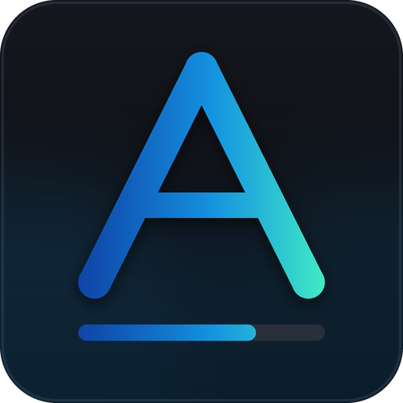
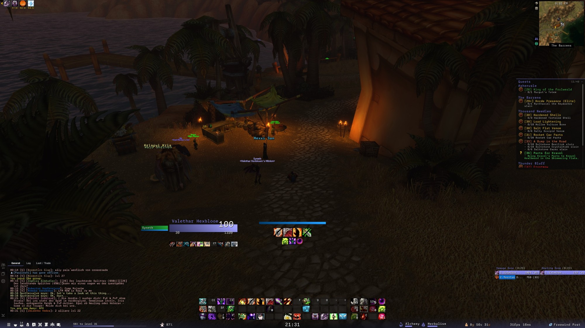
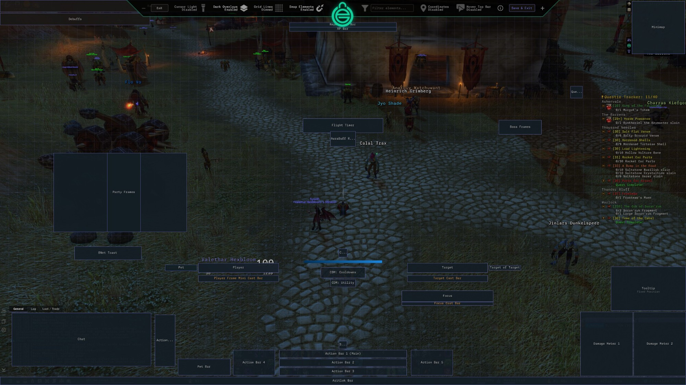

<p align="center">
  
</p>

<h1 align="center">AritlokUI</h1>

<p align="center">
  A dark, flat interface overhaul for <b>World of Warcraft: Forever</b>, built on EllesmereUI.
</p>

<p align="center">
  <a href="https://www.curseforge.com/wow/addons/aritlokui"><b>Download on CurseForge</b></a>
</p>



<details>
<summary>The layout, shown in EllesmereUI's unlock mode</summary>



</details>

## Features

- **Gradient unit frames** – class-colored bars that run from a deep left end to a bright right end, on health, power and cast bars
- **Two themes** – Gradient (default) and Dark
- **Clean center layout** – player and target frames either side of a free center, with the power bar and cooldown manager in between
- **Compact action bars** – three rows at the bottom center, two side blocks, and a mouse-over bar next to chat
- **Menu bar** – a slim strip along the bottom edge with a fading backdrop: micro menu, a long experience bar, durability, clock, professions, gold and performance
- **Tidy screen edges** – chat bottom left; minimap, quest tracker, tooltip and damage / healing meters down the right
- **Step-by-step installer** – short pages, every part optional, with a check that your EllesmereUI version is the tested one
- **Shared or own profile** – install into the shared `AritlokUI` profile or one with a name you choose
- **Out-of-combat hiding** – choose whether action bars, pet bar, unit frames and meters hide outside combat
- **RestedXP Guides** – adds an "AritlokUI" theme to RestedXP: guide window, arrow, map pins and tooltips in your accent color and interface font
- **Questie** – when Questie is loaded, its quest tracker can take the place of EllesmereUI's, in the same font and spot
- **Pixel-perfect scale** – one UI unit per screen pixel (0.5333 at 2560 × 1440)
- **Monaspace Neon** font, with Argon bundled as an alternative
- **Non-destructive** – your EllesmereUI profile is copied, never overwritten
- **English, German and French** – the installer, settings page and chat messages follow your client language

## Requirements

### Required AddOns

- [EllesmereUI](https://github.com/EllesmereGaming/EllesmereUI)

AritlokUI styles and arranges these EllesmereUI modules, so keep them enabled:

| Module | Used for |
| --- | --- |
| Unit Frames | player, target, pet, target-of-target, focus |
| Action Bars | bars 1–6, stance and pet bars |
| Resource Bars | its standalone cast bar is switched off in favor of the one under the player frame |
| DataBars | the menu bar |
| Cooldown Manager | the rows between the player and target frames |
| Chat | chat position, size and fonts |
| Damage Meters | damage and healing windows |
| Quest Tracker | tracker position and size |
| Minimap | minimap position |

A module that is switched off is simply skipped by the installer.

### Game version

World of Warcraft: Forever, interface `16001`.

## Installation

- Make a backup of your `WTF` folder
- Install EllesmereUI and log in once with it enabled
- Install AritlokUI from [CurseForge](https://www.curseforge.com/wow/addons/aritlokui), or put this folder into `World of Warcraft/_forever_/Interface/AddOns/` and make sure it is named `AritlokUI` (the name has to match `AritlokUI.toc`)
- Restart the game client (a new addon folder is not picked up by `/reload`)
- Type `/aui install` and follow the steps
- Click **Reload UI** on the last page

The installer copies your active EllesmereUI profile to a new one and writes its settings there: either the shared `AritlokUI` profile or one you name yourself. Your original profile is left as it was; you can switch back to it under `/eui` → Profiles. A profile that already exists and was not made by AritlokUI is never written into.

## Commands

| Command | What it does |
| --- | --- |
| `/aui` | open the settings page inside the EllesmereUI panel |
| `/aui install` | open the installer |
| `/aui shade on\|off\|<0-90>` | bar gradients, and how deep the left end gets |
| `/aui bar on\|off\|top\|bottom` | the menu bar's backdrop and experience bar |
| `/aui xp <length> [offset]` | length of the experience bar on the menu bar, and where it starts |
| `/aui status` | what is switched on |
| `/aui probe` | print which client and EllesmereUI functions this build has |
| `/aui help` | list the commands |

`/aritlokui` works as an alias for `/aui`.

## What it does not do

- It does not read the combat log.
- It does not automate any combat decision.
- It does not replace Blizzard's unit frames, damage meter or cooldown manager itself; it arranges what EllesmereUI provides.
- It compiles no secure snippets and writes no attributes onto Blizzard frames.

## Known limits

- Bundled layout values are tuned on a 2560 × 1440 screen. Everything is scaled to your screen height, but other aspect ratios are less tested.
- Unit names are not gradient-colored: that would mean altering the name text, which this addon never touches.
- The installer writes EllesmereUI settings that were read from EllesmereUI 9.8.4. On another version it warns you, and some settings may not apply.
- The menu bar is built through an internal EllesmereUI table. If an EllesmereUI update changes it, the installer leaves the menu bar out and says so.
- The pixel-perfect UI scale is account-wide in EllesmereUI, so it also applies to your other profiles.
- Action buttons are 36 × 29 rather than a flatter shape, because that is the flattest EllesmereUI draws without stretching the icons.

## Development

This repository is the addon folder itself. To work on it, either clone it straight into your AddOns directory as `AritlokUI`, or keep it elsewhere and link it in.

### Clone into AddOns

```
cd "World of Warcraft/_forever_/Interface/AddOns"
git clone <repository url> AritlokUI
```

### Windows link

Open Command Prompt **as administrator**:

```
mklink /J "D:\Games\World of Warcraft\_forever_\Interface\AddOns\AritlokUI" "C:\path\to\AritlokUI"
```

Changes to existing files load with `/reload`. New files, and changes to the `.toc`, need a full client restart.

### Checks and releases

Every push to `main` and every pull request runs the **Test** workflow: a StyLua formatting check (run `stylua .` before committing), luacheck, plus checks that each Lua file starts with the namespace line, that nothing forbidden is used (combat log, secure snippets), and that the TOC matches the files.

Releases are made by pushing a tag from `main`:

| Tag | Result |
| --- | --- |
| `v0.2.0-beta.1` | beta file |
| `v0.2.0` | stable file (the tag must match `## Version:` in the TOC) |

Before tagging, update `## Version:` in `AritlokUI.toc`, `ns.VERSION` in `Core/Core.lua`, `CHANGELOG.md`, and `Core/Changelog.lua` (the same notes, shown in game).

### Layout of the addon

| Path | Purpose |
| --- | --- |
| `AritlokUI.toc` | load order and metadata (has to stay in the root) |
| `Core/Core.lua` | namespace, saved variables, the single event frame, combat queue, probe |
| `Core/Changelog.lua` | release notes for the in-game Changelog page |
| `Core/Locale.lua` | the translation table |
| `Locales/` | German and French texts |
| `Core/Media.lua` | textures, fonts, color and gradient helpers |
| `Modules/Shade.lua` | gradient overlays on EllesmereUI's unit frame bars |
| `Modules/InfoBar.lua` | the menu bar's fading backdrop and the long experience bar |
| `Modules/RestedXP.lua` | the theme registered with RestedXP Guides |
| `Modules/Options.lua` | settings page, slash command, addon compartment entry |
| `Modules/Installer/Core.lua` | the option list, screen geometry, and the install run |
| `Modules/Installer/Look.lua` | style, font, accent color, UI scale |
| `Modules/Installer/MenuBar.lua` | the menu bar (EllesmereUI DataBars) |
| `Modules/Installer/UnitFrames.lua` | unit frames, cast bars, cooldown manager rows |
| `Modules/Installer/ActionBars.lua` | action, stance and pet bars |
| `Modules/Installer/Chat.lua` | chat position, fonts and docking |
| `Modules/Installer/RightEdge.lua` | minimap, quest tracker, tooltip, meters |
| `Modules/Installer/Combat.lua` | what is hidden out of combat |
| `Modules/Installer/Addons.lua` | settings for other addons (Questie, RestedXP) |
| `Modules/Installer/Wizard.lua` | the installer window |
| `Media/` | textures and fonts used in game |
| `Assets/` | images for this README (left out of releases) |
| `.pkgmeta` | what a release contains |
| `CHANGELOG.md` | shown on CurseForge with each release |

Each file under `Modules/Installer` registers its own step, so a new part of the layout is one new file plus one entry in the option list.

### Translations

Texts are written in English in the code and looked up through `ns.L["English text"]`. To add a language, copy `Locales/deDE.lua`, change the locale code at the top, translate the right-hand side of each line, and list the file in `AritlokUI.toc`. A text with no translation shows in English. Placeholders such as `%s` and `%d` have to stay in the same order.

## Credits

- **Ellesmere** for [EllesmereUI](https://github.com/EllesmereGaming/EllesmereUI), which AritlokUI is built on
- **Toxi** and the [ToxiUI](https://github.com/Toxicom/toxiui) contributors, whose layout this one is modeled on
- **Smokenoaken** for [OakUI](https://github.com/Smokenoaken/OakUI_Installer), the reference for the menu bar
- **GitHub Next** for the [Monaspace](https://github.com/githubnext/monaspace) typeface

## License

AritlokUI is released under the [MIT License](LICENSE).

The Monaspace fonts in `Media/Fonts` are © GitHub and distributed unmodified under the SIL Open Font License 1.1. The license text is in `Media/Fonts/Monaspace-LICENSE.txt`.
